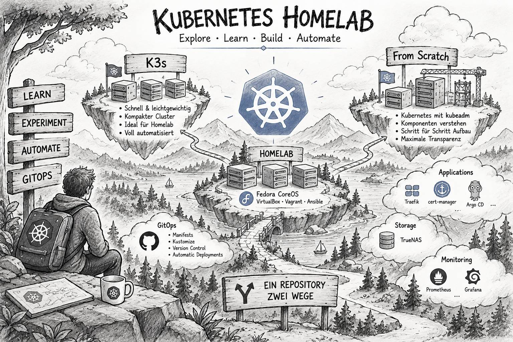

# Kubernetes Homelab

  

      
---

### Inhaltsverzeichnis

* [Kubernetes Clusters with K3s](README_k3s.md)
* [Kubernetes Clusters from Scratch](README_scratch.md)

---

## Beschreibung

Dieses Repository dokumentiert den Aufbau und Betrieb eines Kubernetes Homelabs zu Lern- und Evaluierungszwecken.

Der Schwerpunkt liegt auf dem praktischen Aufbau von Kubernetes-Clustern, der Automatisierung der Infrastruktur und der schrittweisen Integration zentraler Plattformkomponenten.

### Projektinhalte

- Fedora CoreOS als Betriebssystem
- Kubernetes mit K3s oder kubeadm
- Automatisierte Infrastruktur Bereitstellung mit Packer, Vagrant und Ansible
- Container Runtime und Container Networking
- Ingress, TLS und Zertifikatsverwaltung mit Traefik und Cert-Manager
- Multi-Node Netzwerk und Network Policies
- Persistenter Storage mit TrueNAS ISCSI
- GitOps und Anwendungsbereitstellung mit Argo CD
- Kubernetes Dashboard mit Headlamp

### Cluster-Varianten

Das Repository enthält zwei Ansätze zum Aufbau eines Kubernetes-Clusters:

**`K3s`**

Ein kompakter Kubernetes Cluster mit K3s. Diese Variante eignet sich für einen schnellen, ressourcenschonenden Aufbau und den Betrieb einer Kubernetes Lernumgebung.

**`From Scratch mit kubeadm`**

Ein Kubernetes Cluster, dessen zentrale Komponenten und Abhängigkeiten schrittweise eingerichtet und konfiguriert werden. Dazu gehören unter anderem die Control-Plane-Komponenten, die Container Runtime, das Container Network Interface (CNI) und die Integration weiterer Plattformdienste.

Die konkreten Installationsschritte, Konfigurationen und Testergebnisse sind jeweils in den verlinkten Dokumentationen beschrieben.

### Infrastruktur und Automatisierung

Die virtuelle Infrastruktur basiert auf VirtualBox und Fedora CoreOS. Packer, Vagrant und Ansible werden zur Erstellung, Bereitstellung und Konfiguration der virtuellen Maschinen eingesetzt.

Die zugehörigen Projekte sind hier zu finden:

- [Packer, Vagrant and Ansible](https://github.com/hth73/hth-ansible-wks)
- [Fedora CoreOS](https://github.com/hth73/hth-coreos)

### Ziel des Projekts

Ziel ist es, praktische Erfahrungen mit Linux, Kubernetes, Container Orchestrierung, Netzwerktechnik, Storage und Infrastructure Automation zu sammeln. Die beiden Cluster Varianten ermöglichen es, sowohl den vereinfachten Einstieg mit `K3s` als auch den schrittweisen Aufbau mit `kubeadm` nachzuvollziehen.
