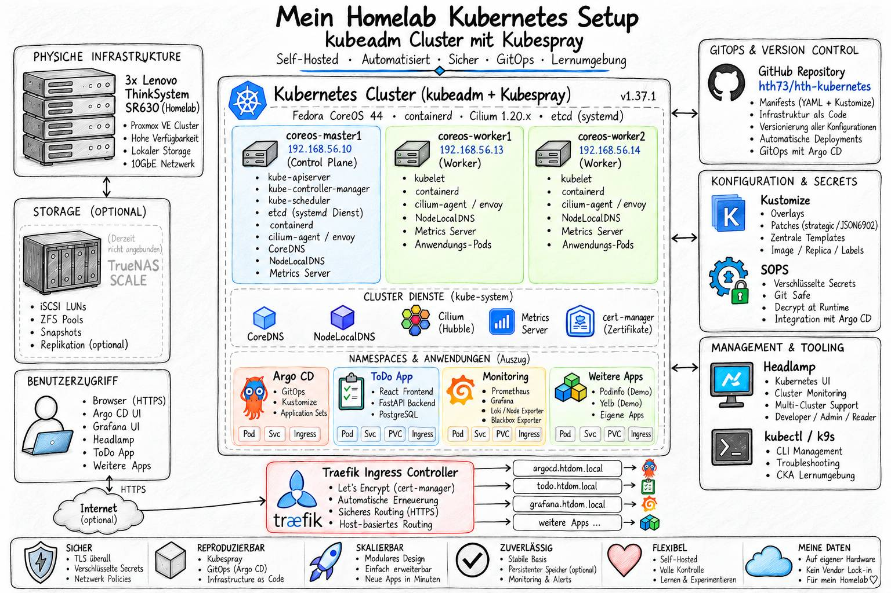

# Kubernetes Clusters with K3s (WIP)

<p>
  
</p>

           
---

### Inhaltsverzeichnis

* [Cert Manager](infrastructure/cert-manager/README.md)
* [etcd - key-value store](infrastructure/etcd/README.md)
* [Node Log Collector - DaemonSet](apps/node-log-collector/README.md)
* [Headlamp Kubernetes UI](infrastructure/dashboard/README.md)
* [Argo CD – GitOps im Kubernetes](infrastructure/argocd/README.md)
* [Kustomize – Kubernetes-Manifeste verwalten](infrastructure/kustomize/README.md)
* [Popeye Kubernetes Live Cluster Linter](infrastructure/popeye/README.md)
* [TrueNAS ISCSI LUNs](infrastructure/iscsi-storage/README.md)
  * [Forgejo Git Server](apps/forgejo/srv/README.md)
  * [Petclinic Demo Application](apps/petclinic/README.md)
  * [Podinfo Demo Application](apps/podinfo/README.md)
  * [yelb Demo Application](apps/yelb/README.md)
  * [Todo List Demo Application](apps/todo/README.md)

---

## Beschreibung

Der Kubernetes-Cluster besteht aus:
- 1-3 Control Plane Master Nodes mit embedded etcd
- 2-3 Worker Nodes

## Aufbau des K3s Kubernetes Cluster

Um ein K3s Kubernetes Cluster aufbauen zu können, benötigt es zwei Repositories und eine funktionierende VirtualBox Umgebung.

* [CoreOS Linux Unattended Installation](https://github.com/hth73/hth-ansible-wks)
* [Kubernetes Homelab](https://github.com/hth73/hth-kubernetes)

### Vorbereitung für das CoreOS Image

```bash
# --------------------------------------------------
# Repositories clonen
# --------------------------------------------------
mkdir -p ~/repos && cd ~/repos
git clone https://github.com/hth73/hth-ansible-wks.git
git clone https://github.com/hth73/hth-kubernetes.git

# --------------------------------------------------
# SSH Key ohne Passphrase für das Deployment erstellen
# --------------------------------------------------
cd hth-ansible-wks
ssh-keygen -o -t ed25519 -f secrets/ssh/id_ed25519 -C'ansible@accesskey'

# --------------------------------------------------
# CoreOS ISO Image downloaden, und den "iso_path" in packer/coreos/coreos.pkr.hcl anpassen
# --------------------------------------------------
mkdir iso
wget -O iso/fedora-coreos-44.20260928.3.1-live-iso.x86_64.iso https://builds.coreos.fedoraproject.org/prod/streams/stable/builds/44.20260928.3.1/x86_64/fedora-coreos-44.20260928.3.1-live-iso.x86_64.iso
```

### CoreOS Ignition-Datei anpassen
```bash
# --------------------------------------------------
# CoreOS Butane Binary lokal installieren
# --------------------------------------------------
sudo wget -O /usr/local/bin/butane https://github.com/coreos/butane/releases/download/v0.29.0/butane-x86_64-unknown-linux-gnu
chmod +x ~/usr/local/bin/butane

butane --version
# Butane 0.29.0

# --------------------------------------------------
# Alle gewünschten SSH Puplic Keys in packer/coreos/config/ansible_config.bu kopieren.
# --------------------------------------------------
cat secrets/ssh/id_ed25519.pub 
ssh-ed25519 AAAAC3NzaC1lZDI1NTE5AAAAIN2X1sQYiP/jSE8CWG+FXKjDYJcfic4mALW71fVB7SfC

# --- packer/coreos/config/ansible_config.bu
# Fedora CoreOS Ansible Butane configuration
# Date: 2026-05-20

variant: fcos
version: 1.6.0

passwd:
 users:
   # Default User core
   - name: core
     ssh_authorized_keys:
       - ssh-ed25519 AAAAC3NzaC1lZDI1NTE5AAAAIN2X1sQYiP/jSE8CWG+FXKjDYJcfic4mALW71fVB7SfC
       - ssh-ed25519 AAAA.....lT

# --------------------------------------------------
# packer/coreos/config/ansible_config.bu in Ignition-Datei konvertieren
# -------------------------------------------------- 
butane --pretty --strict packer/coreos/config/ansible_config.bu > packer/coreos/config/ansible_config.ign

# --------------------------------------------------
# Create an ignition checksum and use it in Packer
# --------------------------------------------------
sha256sum packer/coreos/config/ansible_config.ign
# 3834f44c52b0b80e..........
# or
sha512sum packer/coreos/config/ansible_config.ign
# 9c4f683ab01ca78f..........

# --------------------------------------------------
# Checksum in packer/coreos/coreos.pkr.hcl anpassen
# --------------------------------------------------
...

variable "ignition_hash" {
  type    = string
  default = "sha256-3834f44c52b0b80e.........."
  # default = "sha512-9c4f683ab01ca78f.........."
}
```

### CoreOS Basis Image bauen mit packer
```bash
cd hth-ansible-wks/packer/coreos

packer init coreos.pkr.hcl
packer validate coreos.pkr.hcl
packer build coreos.pkr.hcl
```

### CoreOS VMs deployen
```bash
cd ../../vagrant/coreos

# --------------------------------------------------
# Vagrantfile_k3s_cluster bei Bedarf anpassen
# --------------------------------------------------
vagrant box add ../../packer/coreos/coreos-base.box --name coreos-base --force
export VAGRANT_VAGRANTFILE=~/repos/hth-ansible-wks/vagrant/coreos/Vagrantfile_k3s_cluster

vagrant validate
# Vagrantfile validated successfully.

vagrant up
```

Um Zugriff auf das Kubernetes Cluster zu bekommen, benötigt man vorher die Kubernetes Client Konfigurationsdatei, diese wird dann im lokalen Verzeichnis unter `$HOME/.kube/config` abgelegt. 

```bash
# --------------------------------------------------
# SSH Key laden
# --------------------------------------------------
eval "$(ssh-agent -s)"
ssh-add ~/repos/hth-ansible-wks/secrets/ssh/id_ed25519

mkdir -p "$HOME/.kube"
umask 077

ssh core@192.168.56.10 'sudo cat /etc/rancher/k3s/k3s.yaml' |
  sed 's#https://127.0.0.1:6443#https://192.168.56.10:6443#' \
  > "$HOME/.kube/config"

chmod 600 "$HOME/.kube/config"

cat "$HOME/.kube/config"
```

Wenn man für jeden Master Node eine eigene Kubeconfig haben möchte, kann man dies über ein kleine Funktion in der ~/.bashrc oder ~/.zshrc umsetzen.

```bash
# --------------------------------------------------
# function catch kube config
# --------------------------------------------------
function m1() {
  local kubeconfig="$HOME/.kube/coreos-master1"

  if [[ ! -f "$kubeconfig" ]]; then
    echo "Fetching kubeconfig from coreos-master1 ..."
    umask 077
    
    ssh core@192.168.56.10 'sudo cat /etc/rancher/k3s/k3s.yaml' |
      sed \
        -e 's#https://127.0.0.1:6443#https://192.168.56.10:6443#' \
        -e 's/name: kubernetes/name: coreos-master1/g' \
        -e 's/cluster: kubernetes/cluster: coreos-master1/g' \
        -e 's/user: kubernetes-admin/user: coreos-master1-admin/g' \
        -e 's/name: kubernetes-admin/name: coreos-master1-admin/g' \
        -e 's/name: kubernetes-admin@kubernetes/name: coreos-master1/g' \
        -e 's/current-context: kubernetes-admin@kubernetes/current-context: coreos-master1/' \
      > "$kubeconfig"
  fi
  export KUBECONFIG="$kubeconfig"
  clear
}

function m2() {
  local kubeconfig="$HOME/.kube/coreos-master2"

  if [[ ! -f "$kubeconfig" ]]; then
    echo "Fetching kubeconfig from coreos-master2 ..."
    mkdir -p "$HOME/.kube"
    umask 077

    ssh core@192.168.56.11 'sudo cat /etc/rancher/k3s/k3s.yaml' |
      sed \
        -e 's#https://127.0.0.1:6443#https://192.168.56.11:6443#' \
        -e 's/name: kubernetes/name: coreos-master2/g' \
        -e 's/cluster: kubernetes/cluster: coreos-master2/g' \
        -e 's/user: kubernetes-admin/user: coreos-master2-admin/g' \
        -e 's/name: kubernetes-admin/name: coreos-master2-admin/g' \
        -e 's/name: kubernetes-admin@kubernetes/name: coreos-master2/g' \
        -e 's/current-context: kubernetes-admin@kubernetes/current-context: coreos-master2/' \
      > "$kubeconfig"

    chmod 600 "$kubeconfig"
  fi
  export KUBECONFIG="$kubeconfig"
  clear
}

function m3() {
# ...
```

Man kann auch die einzelnen Kubeconfigs zu einer Datei zusammenfügen und wechselt dann nur noch den passenden Kontext.

```bash
KUBECONFIG="$HOME/.kube/coreos-master1:$HOME/.kube/coreos-master2:$HOME/.kube/coreos-master3" \
  kubectl config view --merge --flatten \
  > "$HOME/.kube/config"

chmod 600 "$HOME/.kube/config"

export KUBECONFIG="$HOME/.kube/config"

kubectl config get-contexts
# CURRENT   NAME             CLUSTER          AUTHINFO               NAMESPACE
# *         coreos-master1   coreos-master1   coreos-master1-admin   
#           coreos-master2   coreos-master2   coreos-master2-admin
#           coreos-master3   coreos-master3   coreos-master3-admin

kubectl config current-context
# coreos-master1

kubectl config use-context coreos-master2               
# Switched to context "coreos-master2".

kubectl config current-context           
# coreos-master2
```


Danach kann man mit dem Tool `kubectl` oder `k9s` auf das Kubernetes Cluster zugreifen und die ersten Tests durchführen.

```bash
kubectl get nodes        
# NAME             STATUS   ROLES                AGE     VERSION
# coreos-master1   Ready    control-plane,etcd   2d15h   v1.36.5+k3s1
# coreos-master2   Ready    control-plane,etcd   2d15h   v1.36.5+k3s1
# coreos-master3   Ready    control-plane,etcd   2d15h   v1.36.5+k3s1
# coreos-worker1   Ready    worker               2d15h   v1.36.5+k3s1
# coreos-worker2   Ready    worker               2d15h   v1.36.5+k3s1

kubectl get namespaces 
# NAME              STATUS   AGE
# default           Active   18h
# kube-node-lease   Active   18h
# kube-public       Active   18h
# kube-system       Active   18h

kubectl get services
# NAME         TYPE        CLUSTER-IP   EXTERNAL-IP   PORT(S)   AGE
# kubernetes   ClusterIP   10.43.0.1    <none>        443/TCP   18h

# nginx demo pod anlegen und auf 3 pods erweitern
kubectl create deployment nginx --image=nginx
kubectl scale deployment nginx --replicas=3

kubectl get pods                                    
# NAME                     READY   STATUS    RESTARTS      AGE
# nginx-56c45fd5ff-7764h   1/1     Running   1 (80m ago)   19h
# nginx-56c45fd5ff-mvfvx   1/1     Running   1 (80m ago)   19h
# nginx-56c45fd5ff-v8npb   1/1     Running   1 (18h ago)   19h

kubectl describe services nginx                 
# Name:                     nginx
# Namespace:                default
# Labels:                   app=nginx
# Annotations:              <none>
# Selector:                 app=nginx
# Type:                     NodePort
# IP Family Policy:         SingleStack
# ...

kubectl expose deployment nginx --port=80 --type=NodePort

kubectl get services                                          
# NAME         TYPE        CLUSTER-IP    EXTERNAL-IP   PORT(S)        AGE
# kubernetes   ClusterIP   10.43.0.1     <none>        443/TCP        19h
# nginx        NodePort    10.43.39.44   <none>        80:30413/TCP   15s

curl http://192.168.56.11:30413
# <!DOCTYPE html>
# <html>
# <head>
# <title>Welcome to nginx!</title>
# ...

kubectl exec -it deploy/nginx -- sh

hostname
# nginx-56c45fd5ff-v8npb

ls -la
# total 4
# ...
# lrwxrwxrwx.   1 root root    7 May  8 16:10 bin -> usr/bin
# ...

## nginx Deployment und Service wieder löschen
kubectl get deployment
kubectl delete deployment nginx
kubectl get deployment

kubectl get services
kubectl delete services nginx
kubectl get services
```
