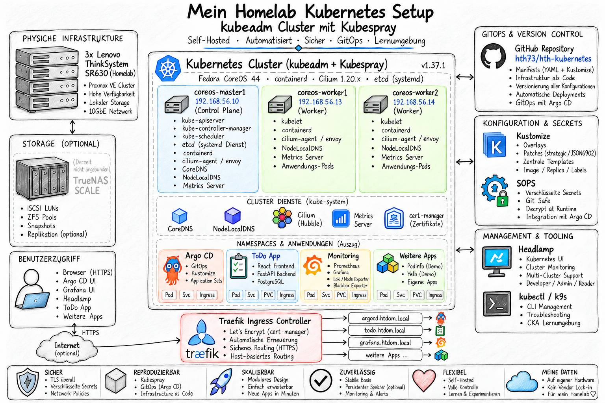

# Kubernetes Clusters from Scratch with kubeadm

<p>
  
</p>

   

Diese Dokumentation beschreibt den manuellen Aufbau eines Kubernetes Clusters mit `kubeadm` auf Basis von Fedora CoreOS.

Die Clusterbereitstellung werden im Repository
[`hth-ansible-wks`](https://github.com/hth73/hth-ansible-wks) verwaltet.

Die Anwendungsmanifeste liegen im Repository
[`hth-kubernetes`](https://github.com/hth73/hth-kubernetes).

## Umgebung

| Knoten           | Rolle         | IP-Adresse      |
| :-------         | :------       | :-------        |
| `coreos-master1` | Control Plane | `192.168.56.10` |
| `coreos-worker1` | Worker        | `192.168.56.13` |
| `coreos-worker2` | Worker        | `192.168.56.14` |

### Vorbereitung für das CoreOS Image

```bash
# --------------------------------------------------
# Repositories klonen
# --------------------------------------------------
mkdir -p ~/repos && cd ~/repos
git clone https://github.com/hth73/hth-ansible-wks.git
git clone https://github.com/hth73/hth-kubernetes.git

# --------------------------------------------------
# SSH-Key ohne Passphrase für das Deployment erstellen
# --------------------------------------------------
cd hth-ansible-wks
ssh-keygen -o -t ed25519 -f secrets/ssh/id_ed25519 -C'ansible@accesskey'

# --------------------------------------------------
# CoreOS-ISO-Image herunterladen und den "iso_path" in packer/coreos/coreos.pkr.hcl anpassen
# --------------------------------------------------
mkdir iso
wget -O iso/fedora-coreos-44.20260928.3.1-live-iso.x86_64.iso https://builds.coreos.fedoraproject.org/prod/streams/stable/builds/44.20260928.3.1/x86_64/fedora-coreos-44.20260928.3.1-live-iso.x86_64.iso
```

### CoreOS-Ignition-Datei anpassen
```bash
# --------------------------------------------------
# CoreOS-Butane-Binary lokal installieren
# --------------------------------------------------
sudo wget -O /usr/local/bin/butane https://github.com/coreos/butane/releases/download/v0.29.0/butane-x86_64-unknown-linux-gnu
chmod +x ~/usr/local/bin/butane

butane --version
# Butane 0.29.0

# --------------------------------------------------
# Alle gewünschten öffentlichen SSH-Keys in packer/coreos/config/ansible_config.bu kopieren.
# --------------------------------------------------
cat secrets/ssh/id_ed25519.pub 
ssh-ed25519 AAAAC3NzaC1lZDI1NTE5AAAAIN2X1sQYiP/jSE8CWG+FXKjDYJcfic4mALW71fVB7SfC

# --- packer/coreos/config/ansible_config.bu
# Fedora CoreOS Ansible Butane configuration
# Date: 2026-05-20

variant: fcos
version: 1.6.0

passwd:
 users:
   # Default User core
   - name: core
     ssh_authorized_keys:
       - ssh-ed25519 AAAAC3NzaC1lZDI1NTE5AAAAIN2X1sQYiP/jSE8CWG+FXKjDYJcfic4mALW71fVB7SfC
       - ssh-ed25519 AAAA.....lT

# --------------------------------------------------
# packer/coreos/config/ansible_config.bu in eine Ignition-Datei konvertieren
# -------------------------------------------------- 
butane --pretty --strict packer/coreos/config/ansible_config.bu > packer/coreos/config/ansible_config.ign

# --------------------------------------------------
# Create an ignition checksum and use it in Packer
# --------------------------------------------------
sha256sum packer/coreos/config/ansible_config.ign
# 3834f44c52b0b80e..........
# or
sha512sum packer/coreos/config/ansible_config.ign
# 9c4f683ab01ca78f..........

# --------------------------------------------------
# Checksumme in packer/coreos/coreos.pkr.hcl anpassen
# --------------------------------------------------
...

variable "ignition_hash" {
  type    = string
  default = "sha256-3834f44c52b0b80e.........."
  # default = "sha512-9c4f683ab01ca78f.........."
}
```

### CoreOS-Basis-Image mit Packer erstellen
```bash
cd hth-ansible-wks/packer/coreos

packer init coreos.pkr.hcl
packer validate coreos.pkr.hcl
packer build coreos.pkr.hcl
```

### CoreOS-VMs bereitstellen
```bash
cd hth-ansible-wks/vagrant/coreos

# --------------------------------------------------
# Vagrantfile_k8s_cluster stellt 3 frische CoreOS Server bereit
# --------------------------------------------------
vagrant box add ../../packer/coreos/coreos-base.box --name coreos-base --force
export VAGRANT_VAGRANTFILE=Vagrantfile_k8s_cluster

vagrant validate
# Vagrantfile validated successfully.

vagrant up
```

- Punkt `1-4` muss auf allen drei Servern durchgeführt werden.
- Punkt 5 und 6 wird nur auf den `coreos-master1` installiert.
- Punkt 7 erfolgt nur auf den beiden `coreos-worker1` und `coreos-worker2`.
- Punkt 8 kann dann wieder über den `coreos-master1` installiert werden oder wenn die `~/.kube/config` auf allen Servern eingerichtet wurde,kann dieser Schritt von überall installiert werden.

## 1. Container Runtime konfigurieren

```bash
# --------------------------------------------------
# 1. Container Runtime konfigurieren
# --------------------------------------------------
sudo cp /etc/containerd/config.toml /etc/containerd/config.toml.backup

# Aktuelle Konfiguration vollständig anzeigen
sudo vi /etc/containerd/config.toml

# --- /etc/containerd/config.toml ---

version = 4

[plugins]
  [plugins."io.containerd.cri.v1.runtime"]
    [plugins."io.containerd.cri.v1.runtime".containerd]
      default_runtime_name = "runc"

      [plugins."io.containerd.cri.v1.runtime".containerd.runtimes]
        [plugins."io.containerd.cri.v1.runtime".containerd.runtimes.runc]
          runtime_type = "io.containerd.runc.v2"

          [plugins."io.containerd.cri.v1.runtime".containerd.runtimes.runc.options]
            SystemdCgroup = true
  
  [plugins."io.containerd.cri.v1.images"]
    snapshotter = "overlayfs"

  [plugins."io.containerd.cri.v1.runtime".cni]
    bin_dirs = ["/opt/cni/bin/"]
    conf_dir = "/etc/cni/net.d"

  [plugins."io.containerd.internal.v1.opt"]
    path = "/var/lib/containerd/opt"

# --- /etc/containerd/config.toml ---

# containerd beim Systemstart automatisch aktivieren und starten
sudo systemctl enable --now containerd
systemctl status containerd --no-pager

sudo containerd config migrate

# Prüfen, ob der containerd-Socket angelegt wurde
sudo ls -l /run/containerd/containerd.sock
# srw-rw----. 1 root root 0 Oct 17 13:46 /run/containerd/containerd.sock
```

## 2. Kubernetes Tools installieren

```bash
cd /tmp
vi k8s_tools.sh

# --- k8s_tools.sh ---

#!/usr/bin/env bash

# Kubernetes-Version festlegen
K8S_VERSION=v1.37.0
CRICTL_VERSION=v1.37.0

# Download-Verzeichnis anlegen
mkdir -p /tmp/k8s
cd /tmp/k8s

# Kubernetes-Werkzeuge herunterladen
for tool in kubeadm kubelet kubectl; do
  curl -fL -o "$tool" "https://dl.k8s.io/release/${K8S_VERSION}/bin/linux/amd64/${tool}"
done

# crictl herunterladen und entpacken
curl -fL -o crictl.tar.gz "https://github.com/kubernetes-sigs/cri-tools/releases/download/${CRICTL_VERSION}/crictl-${CRICTL_VERSION}-linux-amd64.tar.gz"
tar -xzf crictl.tar.gz crictl

# Werkzeuge installieren
sudo install -m 0755 kubeadm kubelet kubectl crictl /usr/local/bin/

# --- k8s_tools.sh ---

bash k8s_tools.sh

command -v kubeadm kubelet kubectl crictl
# /usr/local/bin/kubeadm
# /usr/local/bin/kubelet
# /usr/local/bin/kubectl
# /usr/local/bin/crictl
```

## 3. kubelet-Service-Vorlage vorbereiten

```bash
# # Verzeichnis für die systemd-Vorlage anlegen
# mkdir -p /tmp/kubelet-systemd

# # Offizielle kubelet-Service Vorlage herunterladen
# curl -fL https://raw.githubusercontent.com/kubernetes/release/v0.16.2/cmd/krel/templates/latest/kubelet/kubelet.service -o /tmp/kubelet-systemd/kubelet.service

# # kubelet-Service auf den Installationspfad anpassen
# sudo sed 's|/usr/bin/kubelet|/usr/local/bin/kubelet|g' /tmp/kubelet-systemd/kubelet.service | sudo tee /etc/systemd/system/kubelet.service

# # Drop-in-Verzeichnis anlegen
# sudo mkdir -p /etc/systemd/system/kubelet.service.d

# # kubeadm-Drop-in installieren und kubelet-Pfad anpassen
# curl -fsSL https://raw.githubusercontent.com/kubernetes/release/v0.16.2/cmd/krel/templates/latest/kubeadm/10-kubeadm.conf \
#   | sed 's|/usr/bin/kubelet|/usr/local/bin/kubelet|g' \
#   | sudo tee /etc/systemd/system/kubelet.service.d/10-kubeadm.conf

# # systemd-Konfiguration neu laden
# sudo systemctl daemon-reload

# kubelet-Service anlegen
sudo tee /etc/systemd/system/kubelet.service <<'EOF'
[Unit]
Description=kubelet: The Kubernetes Node Agent
Documentation=https://kubernetes.io/docs/
Wants=network-online.target
After=network-online.target

[Service]
ExecStart=/usr/local/bin/kubelet
Restart=always
RestartSec=10

[Install]
WantedBy=multi-user.target
EOF

# kubeadm-Drop-in anlegen
sudo mkdir -p /etc/systemd/system/kubelet.service.d

sudo tee /etc/systemd/system/kubelet.service.d/10-kubeadm.conf <<'EOF'
[Service]
Environment="KUBELET_KUBECONFIG_ARGS=--bootstrap-kubeconfig=/etc/kubernetes/bootstrap-kubelet.conf --kubeconfig=/etc/kubernetes/kubelet.conf"
Environment="KUBELET_CONFIG_ARGS=--config=/var/lib/kubelet/config.yaml"
EnvironmentFile=-/var/lib/kubelet/kubeadm-flags.env
EnvironmentFile=-/etc/sysconfig/kubelet
ExecStart=
ExecStart=/usr/local/bin/kubelet $KUBELET_KUBECONFIG_ARGS $KUBELET_CONFIG_ARGS $KUBELET_KUBEADM_ARGS $KUBELET_EXTRA_ARGS
EOF

# systemd-Konfiguration neu laden
sudo systemctl daemon-reload

cat /etc/systemd/system/kubelet.service
# [Unit]
# Description=kubelet: The Kubernetes Node Agent
# Documentation=https://kubernetes.io/docs/
# Wants=network-online.target
# After=network-online.target

# [Service]
# ExecStart=/usr/local/bin/kubelet
# Restart=always
# RestartSec=10

# [Install]
# WantedBy=multi-user.target

cat /etc/systemd/system/kubelet.service.d/10-kubeadm.conf
# [Service]
# Environment="KUBELET_KUBECONFIG_ARGS=--bootstrap-kubeconfig=/etc/kubernetes/bootstrap-kubelet.conf --kubeconfig=/etc/kubernetes/kubelet.conf"
# Environment="KUBELET_CONFIG_ARGS=--config=/var/lib/kubelet/config.yaml"
# EnvironmentFile=-/var/lib/kubelet/kubeadm-flags.env
# EnvironmentFile=-/etc/sysconfig/kubelet
# ExecStart=
# ExecStart=/usr/local/bin/kubelet $KUBELET_KUBECONFIG_ARGS $KUBELET_CONFIG_ARGS $KUBELET_KUBEADM_ARGS $KUBELET_EXTRA_ARGS

# Bridge Netzwerkmodul laden
sudo modprobe br_netfilter

# IPv4 Forwarding aktivieren
sudo sysctl -w net.ipv4.ip_forward=1

# Kubernetes-Netzwerkeinstellungen dauerhaft konfigurieren
sudo tee /etc/sysctl.d/99-kubernetes.conf <<'EOF'
net.ipv4.ip_forward = 1
net.bridge.bridge-nf-call-iptables = 1
net.bridge.bridge-nf-call-ip6tables = 1
EOF

# Einstellungen laden
sudo sysctl --system

# Kernel-Modul dauerhaft für den Systemstart vormerken
echo br_netfilter | sudo tee /etc/modules-load.d/kubernetes.conf
```

## 4. CNI Plugin installieren

```bash
# --------------------------------------------------
# 4. CNI Plugin installieren
# --------------------------------------------------
# CNI-Plugin-Version festlegen
CNI_VERSION=v1.9.1

# CNI-Plugins herunterladen
curl -fL -o /tmp/cni-plugins.tgz "https://github.com/containernetworking/plugins/releases/download/${CNI_VERSION}/cni-plugins-linux-amd64-${CNI_VERSION}.tgz"

# Installationsverzeichnis anlegen
sudo mkdir -p /opt/cni/bin

# Plugins installieren
sudo tar -C /opt/cni/bin -xzf /tmp/cni-plugins.tgz

ls -la /opt/cni/bin
# ...
# -rwxr-xr-x. 1 root root  4389084 Mar 16  2026 tuning
# -rwxr-xr-x. 1 root root  5267679 Mar 16  2026 vlan
# -rwxr-xr-x. 1 root root  4685012 Mar 16  2026 vrf

# Prüfen, ob Swap aktiviert ist (Muss deaktiviert sein)
swapon --show
```

## 5. Control Plane initialisieren

```bash
# --------------------------------------------------
# 5. Control Plane initialisieren
# --------------------------------------------------
# kubelet für den Systemstart aktivieren
sudo systemctl enable kubelet.service

# Kubernetes-Control-Plane initialisieren
sudo kubeadm init --apiserver-advertise-address=192.168.56.10 --pod-network-cidr=10.100.0.0/16 --skip-phases=addon/kube-proxy --cri-socket=unix:///run/containerd/containerd.sock
# [init] Using Kubernetes version: v1.37.1
# [preflight] Running pre-flight checks
# [preflight] Pulling images required for setting up a Kubernetes cluster
# [preflight] This might take a minute or two, depending on the speed of your internet connection
# [preflight] You can also perform this action beforehand using 'kubeadm config images pull'
# ...
# [bootstrap-token] Configuring bootstrap tokens, cluster-info ConfigMap, RBAC Roles
# [bootstrap-token] Configured RBAC rules to allow Node Bootstrap tokens to get nodes
# [bootstrap-token] Configured RBAC rules to allow Node Bootstrap tokens to post CSRs in order for nodes to get long term certificate credentials
# [bootstrap-token] Configured RBAC rules to allow the csrapprover controller automatically approve CSRs from a Node Bootstrap Token
# [bootstrap-token] Configured RBAC rules to allow certificate rotation for all node client certificates in the cluster
# [bootstrap-token] Configured RBAC rules to allow the API server kubelet client certificate to access the kubelet API
# [bootstrap-token] Creating the "cluster-info" ConfigMap in the "kube-public" namespace
# [kubelet-finalize] Updating "/etc/kubernetes/kubelet.conf" to point to a rotatable kubelet client certificate and key
# [addons] Applied essential addon: CoreDNS

# kubectl-Konfiguration für den aktuellen Benutzer einrichten
mkdir -p "$HOME/.kube"
sudo cp /etc/kubernetes/admin.conf "$HOME/.kube/config"
sudo chown "$(id -u):$(id -g)" "$HOME/.kube/config"

kubectl config get-contexts
# CURRENT   NAME                          CLUSTER      AUTHINFO           NAMESPACE
# *         kubernetes-admin@kubernetes   kubernetes   kubernetes-admin  

kubectl get nodes
# NAME             STATUS     ROLES           AGE    VERSION
# coreos-master1   NotReady   control-plane   2m7s   v1.37.0

kubectl get pods -n kube-system
# NAME                                     READY   STATUS    RESTARTS   AGE
# coredns-559f6c778d-5vxgt                 0/1     Pending   0          2m30s
# coredns-559f6c778d-cf29r                 0/1     Pending   0          2m30s
# etcd-coreos-master1                      1/1     Running   0          2m38s
# kube-apiserver-coreos-master1            1/1     Running   0          2m39s
# kube-controller-manager-coreos-master1   1/1     Running   0          2m38s
# kube-scheduler-coreos-master1            1/1     Running   0          2m38s

sudo tee /etc/sysconfig/kubelet <<'EOF'
KUBELET_EXTRA_ARGS=--node-ip=192.168.56.10
EOF
sudo systemctl restart kubelet
```

## 6. Cilium CNI Netzwerk initialisieren und installieren

```bash
# --------------------------------------------------
# 6. Cilium CNI initialisieren
# --------------------------------------------------

# Aktuelle stabile Cilium-CLI-Version ermitteln
cd /tmp

CILIUM_CLI_VERSION=$(curl -fsSL https://raw.githubusercontent.com/cilium/cilium-cli/main/stable.txt)
echo "Cilium CLI: ${CILIUM_CLI_VERSION}"

# CLI herunterladen und Prüfsumme verifizieren
curl -fL -o cilium-linux-amd64.tar.gz "https://github.com/cilium/cilium-cli/releases/download/${CILIUM_CLI_VERSION}/cilium-linux-amd64.tar.gz"
curl -fL -o cilium-linux-amd64.tar.gz.sha256sum "https://github.com/cilium/cilium-cli/releases/download/${CILIUM_CLI_VERSION}/cilium-linux-amd64.tar.gz.sha256sum"
sha256sum --check cilium-linux-amd64.tar.gz.sha256sum

# CLI installieren
sudo tar -C /usr/local/bin -xzf cilium-linux-amd64.tar.gz

ls -la /usr/local/bin
# -rwxr-xr-x.  1 hth  hth  161357984 Sep 24 08:53 cilium
# -rwxr-xr-x.  1 root root  40319387 Oct 16 14:43 crictl
# -rwxr-xr-x.  1 root root  74576034 Oct 16 14:43 kubeadm
# -rwxr-xr-x.  1 root root  61886626 Oct 16 14:43 kubectl
# -rwxr-xr-x.  1 root root  61243657 Oct 16 14:43 kubelet

# Native Network
helm upgrade --install cilium cilium/cilium --version 1.20.4 --namespace kube-system --values infrastructure/cilium/values_native.yaml

# oder

# Overlay Network
helm upgrade --install cilium cilium/cilium --version 1.20.4 --namespace kube-system --values infrastructure/cilium/values_vxlan.yaml

# Hubble client
HUBBLE_VERSION=$(curl -s https://raw.githubusercontent.com/cilium/hubble/main/stable.txt)
HUBBLE_ARCH=amd64
if [ "$(uname -m)" = "aarch64" ]; then HUBBLE_ARCH=arm64; fi
curl -L --fail --remote-name-all https://github.com/cilium/hubble/releases/download/$HUBBLE_VERSION/hubble-linux-${HUBBLE_ARCH}.tar.gz{,.sha256sum}
sha256sum --check hubble-linux-${HUBBLE_ARCH}.tar.gz.sha256sum
sudo tar xzvfC hubble-linux-${HUBBLE_ARCH}.tar.gz /usr/local/bin
rm hubble-linux-${HUBBLE_ARCH}.tar.gz{,.sha256sum}

# Bei Bedarf DaemonSet neu starten
kubectl rollout restart daemonset/cilium -n kube-system
# daemonset.apps/cilium restarted

kubectl get nodes -o wide
# NAME             STATUS   ROLES           AGE   VERSION   INTERNAL-IP     EXTERNAL-IP   OS-IMAGE                        KERNEL-VERSION                  CONTAINER-RUNTIME
# coreos-master1   Ready    control-plane   11m   v1.37.0   192.168.56.10   <none>        Fedora CoreOS 44.20260928.3.1   7.2.7-200.fc44.x86_64 (amd64)   containerd://2.3.5

kubectl get pods -n kube-system -o wide
# NAME                                     READY   STATUS    RESTARTS   AGE     IP              NODE             NOMINATED NODE   READINESS GATES
# cilium-envoy-2rkvs                       1/1     Running   0          5m41s   192.168.56.10   coreos-master1   <none>           <none>
# cilium-gxtcj                             1/1     Running   0          4m55s   192.168.56.10   coreos-master1   <none>           <none>
# cilium-operator-77547dbcf-5g5j8          1/1     Running   0          5m41s   192.168.56.10   coreos-master1   <none>           <none>
# coredns-559f6c778d-5vxgt                 1/1     Running   0          12m     10.100.0.90     coreos-master1   <none>           <none>
# coredns-559f6c778d-cf29r                 1/1     Running   0          12m     10.100.0.21     coreos-master1   <none>           <none>
# etcd-coreos-master1                      1/1     Running   0          12m     10.0.2.15       coreos-master1   <none>           <none>
# hubble-relay-6cd684f4dc-ctd5n            0/1     Pending   0          5m41s   <none>          <none>           <none>           <none>
# hubble-ui-7b5f75765b-qqgq7               0/2     Pending   0          5m41s   <none>          <none>           <none>           <none>
# kube-apiserver-coreos-master1            1/1     Running   0          12m     10.0.2.15       coreos-master1   <none>           <none>
# kube-controller-manager-coreos-master1   1/1     Running   0          12m     10.0.2.15       coreos-master1   <none>           <none>
# kube-scheduler-coreos-master1            1/1     Running   0          12m     10.0.2.15       coreos-master1   <none>           <none>

kubectl get configmap cilium-config -n kube-system -o yaml | grep -E 'ipam|cluster-pool'
#   cluster-pool-ipv4-cidr: 10.100.0.0/16
#   cluster-pool-ipv4-mask-size: "24"
#   default-lb-service-ipam: lbipam
#   enable-lb-ipam: "true"
#   ipam: cluster-pool
#   ipam-cilium-node-update-rate: 15s

kubectl -n kube-system exec ds/cilium -- cilium-dbg status --verbose

# Wenn die Internal IP Adresse nicht sauber erkannt werden
kubectl get ciliumnodes -o custom-columns='NAME:.metadata.name,INTERNAL-IP:.spec.addresses[0].ip,HEALTH-IP:.spec.health.ipAddr'
# NAME             INTERNAL-IP     HEALTH-IP
# coreos-master1   192.168.56.10   <none>
# coreos-worker1   192.168.56.13   <none>
# coreos-worker2   10.0.2.15       <none>

kubectl patch ciliumnode coreos-master1 --type='json' -p='[{"op":"replace","path":"/spec/addresses/0/ip","value":"192.168.56.10"}]'
kubectl patch ciliumnode coreos-worker1 --type='json' -p='[{"op":"replace","path":"/spec/addresses/0/ip","value":"192.168.56.13"}]'
kubectl patch ciliumnode coreos-worker2 --type='json' -p='[{"op":"replace","path":"/spec/addresses/0/ip","value":"192.168.56.14"}]'

kubectl get ciliumnodes -o custom-columns='NAME:.metadata.name,INTERNAL-IP:.spec.addresses[0].ip,HEALTH-IP:.spec.health.ipAddr'
NAME             INTERNAL-IP     HEALTH-IP
coreos-master1   192.168.56.10   <none>
coreos-worker1   192.168.56.13   <none>
coreos-worker2   192.168.56.14   <none>

# Nachdem die Worker hinzugefügt wurden

# master1
sudo tee /etc/sysconfig/kubelet <<'EOF'
KUBELET_EXTRA_ARGS=--node-ip=192.168.56.10
EOF

kubectl get nodes -o name | grep '^node/coreos-worker' \
  | while read -r node; do
      kubectl label "$node" node-role.kubernetes.io/worker=true --overwrite
    done
```
