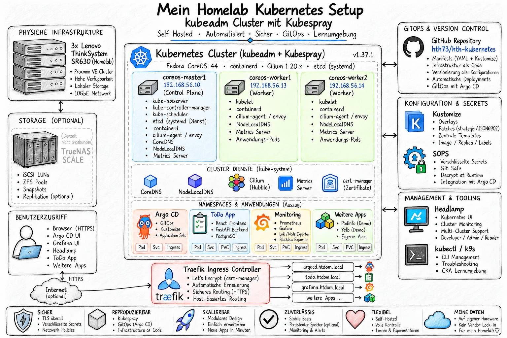

# Kubernetes Cluster from Scratch mit KubeOne

<p>
  
</p>

    


## 1. Architektur und Versionsstand

| Komponente         | Stand                                                     |
| ------------------ | --------------------------------------------------------- |
| Provisionierung    | Packer (Image), Vagrant / VirtualBox (VMs)                |
| Betriebssystem     | Flatcar Container Linux `4757.2.3`                        |
| Cluster-Management | KubeOne `v1.15.0`                                         |
| Kubernetes         | `v1.37.2`                                                 |
| Container Runtime  | containerd `2.2.5`                                        |
| CNI                | Cilium `1.20.4` (Helm-Release über KubeOne)               |
| kube-proxy         | nicht installiert, Cilium `kubeProxyReplacement: true`    |
| Routing            | Native Routing, `autoDirectNodeRoutes: true`              |
| Verschlüsselung    | WireGuard (Pod-zu-Pod)                                    |
| IPAM               | Cilium `multi-pool`, festes `/24` pro Node                |
| Hubble             | deaktiviert                                               |
| Pod-Netz           | `172.20.0.0/16`                                           |
| Service-Netz       | `10.96.0.0/12`                                            |
| Node-Netz          | Bridged LAN `192.168.178.0/24`, Interface `enp0s8`        |
| NAT-Interface      | `enp0s3` (Vagrant-Standard, Egress-Masquerading)          |
| cert-manager       | `v1.21.3` (Root-CA + Sub-CA als ClusterIssuer)            |
| MetalLB            | `0.16.2`, L2-Modus, Pool `192.168.178.230-239`            |
| Ingress            | Traefik Chart `42.4.0`, 2 Replicas auf den Workern        |

### Nodes

| Node              | Rolle         | IP (enp0s8)       | Pod-CIDR          | RAM  | CPUs |
| ----------------- | ------------- | ----------------- | ----------------- | ---- | ---- |
| `flatcar-master1` | Control Plane | `192.168.178.210` | `172.20.210.0/24` | 8 GB | 2    |
| `flatcar-worker1` | Worker        | `192.168.178.213` | `172.20.213.0/24` | 4 GB | 2    |
| `flatcar-worker2` | Worker        | `192.168.178.214` | `172.20.214.0/24` | 4 GB | 2    |

Das dritte Oktett des Pod-CIDR entspricht dem letzten Oktett der Node-IP.
Diese feste Zuordnung pro Node ist eine **Vorgabe** (siehe Abschnitt 6.3).

## 2. Repository-Struktur

```text
hth-ansible-wks/
├── Makefile                          # bootstrap / platform / verify (aus dem Root starten)
├── packer/flatcar/
│   ├── flatcar.pkr.hcl               # Packer-Build -> flatcar-base.box
│   └── config/
│       ├── ansible_config.bu         # Butane-Quelle
│       └── ansible_config.ign        # daraus erzeugte Ignition-Datei
├── vagrant/flatcar/
│   └── Vagrantfile_k8s_cluster       # 3 Flatcar-VMs, Bridged LAN
├── secrets/ssh/id_ed25519            # SSH-Key fuer User core (nicht im Git)
└── inventory/kubeone/
    ├── kubeone.yaml                  # Cluster-Manifest
    └── helm/
        ├── charts/
        │   └── cilium-node-ipam/     # lokales Chart: CiliumNodeConfig je Node
        ├── values/
        │   ├── cilium.yaml
        │   ├── cert-manager.yaml
        │   └── traefik.yaml
        └── configs/                  # Manifeste nach den Charts
            ├── cert-manager/         # Root-CA, Sub-CA, ClusterIssuer
            └── metallb/              # IPAddressPool, L2Advertisement
```

## 3. Ablauf im Überblick

```text
1. Packer        Flatcar-Image bauen          -> packer/flatcar/flatcar-base.box
2. Vagrant       3 VMs erzeugen               -> 192.168.178.210/213/214
3. make bootstrap  KubeOne: Kubernetes + Cilium -> Master init, Cilium, Worker-Join
4. make platform   Helm: cert-manager, MetalLB, Traefik + Configs
5. make verify     Cluster pruefen
```

## 4. Flatcar-Image mit Packer bauen

### 4.1 Ignition-Datei erzeugen

```bash
# Butane einmalig installieren
sudo wget -O /usr/local/bin/butane https://github.com/coreos/butane/releases/download/v0.29.0/butane-x86_64-unknown-linux-gnu
sudo chmod +x /usr/local/bin/butane
butane --version

# Butane -> Ignition
cd packer/flatcar/config
butane --pretty --strict ansible_config.bu > ansible_config.ign

# Hash bei Bedarf in Packer hinterlegen
sha256sum ansible_config.ign
```

Die Ignition-Datei legt die User `core` und `hth` mit SSH-Zugang an.

### 4.2 Packer-Build

Das Flatcar-ISO wird lokal erwartet (Variable `iso_path` in
`flatcar.pkr.hcl`, Standard `/home/hth/vbox/images/flatcar_production_iso_image.iso`).

```bash
cd packer/flatcar
packer init flatcar.pkr.hcl
packer validate flatcar.pkr.hcl
packer build flatcar.pkr.hcl

ls -la flatcar-base.box
```

Packer startet eine VirtualBox-VM vom ISO, installiert Flatcar unbeaufsichtigt
mit `flatcar-install` und der Ignition-Datei, fährt die VM herunter und
exportiert sie als `flatcar-base.box`.

## 5. VMs mit Vagrant erzeugen

### 5.1 Box registrieren

```bash
cd vagrant/flatcar
vagrant box add ../../packer/flatcar/flatcar-base.box --name flatcar-base --force
```

### 5.2 Vagrantfile auswählen und VMs starten

```bash
# einmalig: sudo apt install direnv -y
cd vagrant/flatcar

# .envrc
export VAGRANT_VAGRANTFILE=Vagrantfile_k8s_cluster
# export VAGRANT_VAGRANTFILE=Vagrantfile_single_host

direnv allow
vagrant up
vagrant status
```

Netzwerk pro VM:

- **Adapter 1 (NAT, `enp0s3`):** Vagrant-Standard, SSH-Portweiterleitung.
- **Adapter 2 (Bridged, `enp0s8`):** feste IP aus `NODES` im Vagrantfile,
  per systemd-networkd (`/etc/systemd/network/10-bridged.network`).
  Die Host-Netzwerkkarte steht in `bridge:` (aktuell `enx00e04c7030d9`) und
  muss bei einem anderen Host angepasst werden.
- `--nicpromisc2 allow-all` ist für MetalLB L2 und Native Routing nötig.

### 5.3 SSH-Zugang prüfen

KubeOne verbindet sich als `core` über den SSH-Agent (`SSH_AUTH_SOCK`).

```bash
ssh-add secrets/ssh/id_ed25519

# nach einem Neuaufbau der VMs alte Host-Keys entfernen
for ip in 192.168.178.210 192.168.178.213 192.168.178.214; do
  ssh-keygen -R "$ip"
  ssh -o StrictHostKeyChecking=accept-new core@"$ip" 'hostname && sudo -n true && echo OK'
done
```

### 5.4 VMs entfernen

```bash
cd vagrant/flatcar
vagrant destroy -f
rm -f ../../inventory/kubeone/kubernetes-kubeconfig
```

## 6. KubeOne

### 6.1 Wichtig: Reihenfolge in KubeOne

`kubeone apply` arbeitet die Schritte in fester Reihenfolge ab:

```text
kubeadm init (Master)
  -> eingebaute Addons (CoreDNS, metrics-server, nodelocaldns)
  -> eigene Addons aus addons.path          (Reihenfolge der Ordner zufaellig!)
  -> helmReleases                           (in der Reihenfolge des Manifests)
  -> Join der Worker
```

Daraus folgt:

- **Keine eigenen KubeOne-Addons**, die CRDs aus Helm-Charts brauchen
  (cert-manager, MetalLB, Cilium-CRs). Sie scheitern endlos, und KubeOne
  erreicht weder die Helm-Releases noch den Worker-Join.
- **Nur Cilium läuft über KubeOne.** Alles, was auf Workern laufen muss
  (cert-manager, Traefik, MetalLB-Controller), kommt erst danach per
  `make platform`.
- Pfade in `chart:` und `valuesFile:` sind **relativ zum Arbeitsverzeichnis**,
  nicht zum Manifest. `kubeone apply` muss daher in `inventory/kubeone`
  laufen. Das Makefile erledigt das.

### 6.2 Relevanter Ausschnitt `kubeone.yaml`

```yaml
clusterNetwork:
  podSubnet: 172.20.0.0/16
  serviceSubnet: 10.96.0.0/12
  cni:
    external: {}            # CNI kommt per helmReleases
  kubeProxy:
    skipInstallation: true

features:
  nodeLocalDNS:
    deploy: true
  metricsServer:
    enable: true

helmReleases:
  - releaseName: cilium-node-ipam          # 1. feste Pod-Pools je Node
    chart: ./helm/charts/cilium-node-ipam
    namespace: kube-system
    wait: true
    timeout: 2m
  - releaseName: cilium                    # 2. Cilium
    chart: cilium
    repoURL: https://helm.cilium.io/
    namespace: kube-system
    version: "1.20.4"
    wait: true
    timeout: 10m
    values:
      - valuesFile: helm/values/cilium.yaml
```

### 6.3 Feste Pod-CIDRs pro Node

Umsetzung über Cilium `multi-pool`-IPAM:

1. `helm/values/cilium.yaml` definiert unter
   `ipam.operator.autoCreateCiliumPodIPPools` je Node einen Pool
   (`master-pool`, `worker1-pool`, `worker2-pool`) mit einem `/24`.
2. Das lokale Chart `helm/charts/cilium-node-ipam` legt je Node eine
   `CiliumNodeConfig` an, die per `kubernetes.io/hostname` den
   Standard-Pool des Nodes setzt (`ipam-default-ip-pool`).
3. Die `CiliumNodeConfig` muss existieren, **bevor** der Cilium-Agent auf dem
   Node startet. Deshalb wird das Chart vor Cilium installiert und bringt die
   CRD `ciliumnodeconfigs.cilium.io` im Ordner `crds/` selbst mit (Helm legt
   `crds/` vor den Templates an). Alle übrigen Cilium-CRDs legt der
   Cilium-Operator an (`operator.skipCRDCreation` **nicht** setzen).

Zuordnung in `helm/charts/cilium-node-ipam/values.yaml`:

```yaml
nodes:
  flatcar-master1: master-pool
  flatcar-worker1: worker1-pool
  flatcar-worker2: worker2-pool
```

**Neuen Node hinzufügen:**

1. VM im Vagrantfile (`NODES`) ergänzen.
2. Pool in `helm/values/cilium.yaml` (`autoCreateCiliumPodIPPools`) ergänzen.
3. Zeile in `helm/charts/cilium-node-ipam/values.yaml` ergänzen.
4. Host in `kubeone.yaml` (`controlPlane` oder `staticWorkers`) ergänzen.
5. `make bootstrap`.

### 6.4 Cilium-Values (`helm/values/cilium.yaml`)

Wesentliche Werte:

```yaml
devices: [enp0s8]
k8sServiceHost: "192.168.178.210"
k8sServicePort: "6443"
egressMasqueradeInterfaces: enp0s3
kubeProxyReplacement: true
routingMode: native
ipv4NativeRoutingCIDR: "172.20.0.0/16"
autoDirectNodeRoutes: true
encryption:
  enabled: true
  type: wireguard
ipam:
  mode: multi-pool
hubble:
  enabled: false
```

## 7. Cluster aufbauen (Makefile)

Alle Befehle im **Repository-Root** `hth-ansible-wks/` ausführen.

| Target           | Inhalt                                                    |
| ---------------- | --------------------------------------------------------- |
| `make bootstrap` | `kubeone apply`: Kubernetes, Cilium, Worker-Join          |
| `make platform`  | cert-manager, MetalLB, Configs, Traefik (Helm + kubectl)  |
| `make verify`    | Nodes, CoreDNS, Cilium, IP-Pools, Pods                    |
| `make cluster`   | `bootstrap` + `platform` + `verify`                       |

```bash
ssh-add secrets/ssh/id_ed25519

# komplett, mit Log-Datei (Rueckfrage von KubeOne bleibt sichtbar)
script -q -e -c 'make cluster KUBEONE_FLAGS="--verbose --debug"' kubeone-apply-debug.log

# oder schrittweise
make bootstrap KUBEONE_FLAGS="--verbose --debug"
make platform
make verify

# ohne script, Rueckfrage automatisch bestaetigen
make cluster KUBEONE_FLAGS="--verbose --debug --auto-approve" 2>&1 | tee kubeone-apply-debug.log
```

Weitere KubeOne-Flags über `KUBEONE_FLAGS`, z. B.:

```bash
make bootstrap KUBEONE_FLAGS="--verbose --force-upgrade"
```

`kubeone` direkt (Subshell, damit die relativen Pfade stimmen):

```bash
(cd inventory/kubeone && kubeone apply --manifest kubeone.yaml --verbose)
(cd inventory/kubeone && kubeone addons list --manifest kubeone.yaml)
```

Kubeconfig für eigene Befehle:

```bash
export KUBECONFIG=$PWD/inventory/kubeone/kubernetes-kubeconfig
```

Versionen der Plattform-Charts lassen sich überschreiben:

```bash
make platform CERT_MANAGER_VERSION=v1.21.3 METALLB_VERSION=0.16.2 TRAEFIK_VERSION=42.4.0
```

## 8. Zustand prüfen

```bash
make verify
```

Zusätzliche Prüfungen:

```bash
# Nodes und Rollen
kubectl get nodes -o wide

# Pod-IPs muessen im Pool ihres Nodes liegen (210 / 213 / 214)
kubectl get pods -A -o wide

# Pools und Node-Zuordnung
kubectl get ciliumpodippools
kubectl get ciliumnodeconfigs -n kube-system
kubectl get ciliumnodes -o yaml | grep -A3 'pools:'

# Cilium
kubectl -n kube-system exec ds/cilium -c cilium-agent -- cilium-dbg status --verbose
kubectl -n kube-system exec ds/cilium -c cilium-agent -- cilium-dbg encrypt status

# kube-proxy darf nicht vorhanden sein
kubectl -n kube-system get ds kube-proxy        # erwartet: NotFound

# Helm-Releases
helm list -A

# cert-manager / MetalLB
kubectl get clusterissuers
kubectl get ipaddresspools,l2advertisements -n metallb-system
```

Auf den Nodes (per SSH):

```bash
ip route                    # Routen zu den Pod-CIDRs der anderen Nodes via enp0s8
lsmod | grep wireguard
sudo wg show
```

## 9. Bekannte Punkte

### kube-proxy-ConfigMap bei erneutem `kubeone apply`

Beobachtet mit KubeOne `v1.15.0` und `kubeProxy.skipInstallation: true`:
Beim Aktualisieren der kubeadm-ConfigMaps (z. B. bei Upgrades) versucht
KubeOne, die ConfigMap `kube-proxy` zu aktualisieren, und scheitert mit:

```text
updating kube-proxy ConfigMap: configmaps "kube-proxy" not found
```

Workaround:

```bash
kubectl create configmap kube-proxy --namespace kube-system --from-literal=config.conf='{}'
```

Der kube-proxy-DaemonSet wird dadurch **nicht** installiert. Vor einem
KubeOne-Upgrade prüfen, ob das Verhalten behoben ist.

### Helm-Releases nicht doppelt verwalten

- `cilium` und `cilium-node-ipam` gehören KubeOne: Änderungen in
  `kubeone.yaml` bzw. `helm/` vornehmen und `make bootstrap` ausführen,
  nicht `helm upgrade` von Hand.
- `cert-manager`, `metallb`, `traefik` werden per `make platform` verwaltet.

## 10. Offene Punkte

- [ ] Hubble (Relay + UI) wieder aktivieren (`hubble.enabled` in `helm/values/cilium.yaml`)
- [ ] `vagrant/flatcar/check_flatcar_cluster.sh` erwartet noch das alte Host-Only-Netz `192.168.56.0/24`
- [ ] Funktionstests: Pod-zu-Pod über Nodes, DNS, ClusterIP-Service, WireGuard-Peers,
      LoadBalancer-IP über MetalLB, Ingress über Traefik
- [ ] Makefile um `up`, `destroy`, `preflight` erweitern, sobald alle Komponenten stabil laufen
