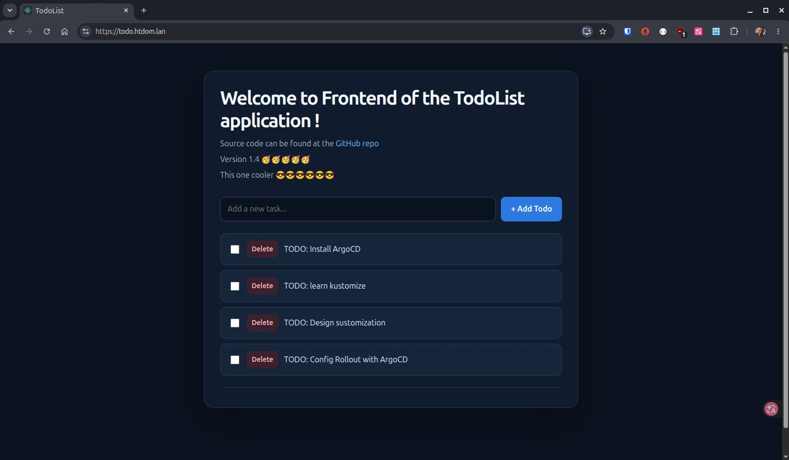

# Todo List Demo Application

<p>
  
</p>

     

---

* [Kubernetes Todo List – React + Python FastAPI + PostgreSQL](https://github.com/fif911/kubernetes-front-end-backend-example)

---

[Back to home](../../README_k3s.md)

---

## Beschreibung

Eine containerisierte Todo-Anwendung, die auf einem lokalen Kubernetes-Cluster betrieben wird. Das Projekt kombiniert ein React-Frontend, ein FastAPI-Backend und eine PostgreSQL-Datenbank mit persistentem Speicher.

Das Projekt ist Teil meiner Kubernetes-Lernumgebung. Es dient dazu, die Bereitstellung von Anwendungen, Netzwerkkommunikation, persistenten Speicher, TLS, Container-Builds und GitOps praktisch zu üben.

## Architektur

Die Anwendung besteht aus drei Komponenten:

| Komponente | Technologie | Kubernetes-Ressourcen |
|---|---|---|
| Frontend | React, nginx | Deployment und Service |
| Backend | FastAPI, Uvicorn | Deployment und Service |
| Datenbank | PostgreSQL 15 | StatefulSet, Service, PV und PVC |

### Ablauf der Anfragen

```text
                         Browser
                            |
                            | HTTPS
                            v
                  Traefik Ingress
                  todo.htdom.lan
                            |
                 +----------+----------+
                 |                     |
              Pfad: /              Pfad: /api
                 |                     |
                 v                     v
             todo-ui:80             todo-app:80
                 |                     |
                 v                     v
           React / nginx          FastAPI-Backend
                                       |
                                       | PostgreSQL
                                       v
                                   todo-db:5432
                                       |
                                       v
                                  Persistenter
                                    Speicher
```

Das Frontend und das Backend sind über denselben Hostnamen erreichbar. Traefik leitet die Anfragen anhand des URL-Pfads an den jeweiligen Service weiter.

## Repository-Struktur

```text
apps/todo/
├── app/
│   ├── backend/
│   │   └── backend.dockerfile
│   ├── deployment.yaml
│   └── service.yaml
├── db/
│   ├── deployment.yaml          # Falls in der aktuellen Struktur vorhanden
│   ├── service.yaml
│   ├── statefulset.yaml
│   ├── pv.yaml
│   └── pvc.yaml
├── ui/
│   ├── frontend/
│   │   ├── src/
│   │   │   ├── components/
│   │   │   ├── index.js
│   │   │   └── App.css
│   │   ├── public/
│   │   ├── env.sh
│   │   └── frontend.dockerfile
│   ├── deployment.yaml
│   ├── service.yaml
│   ├── ingress.yaml
│   └── server-certificate.yaml
├── docker-compose.yaml
├── kustomization.yaml
├── namespace.yaml
└── README.md
```

Die tatsächlichen Dateinamen der Datenbank-Manifeste sollten mit den Dateien im Repository übereinstimmen.

## Kubernetes-Umgebung

Die Anwendung läuft im Namespace `todo` auf dem lokalen K3s-Cluster.

| Ressource | Name | Port |
|---|---|---:|
| Frontend-Service | `todo-ui` | 80 |
| Backend-Service | `todo-app` | 80 |
| Datenbank-Service | `todo-db` | 5432 |
| Ingress | `todo-ui` | 80 / 443 |
| TLS-Secret | `todo-pki-secret` | — |
| Datenbank-Secret | `todo-db-secret` | — |

Die Workloads werden über Node-Selector auf Worker-Nodes geplant. PostgreSQL verwendet persistenten Speicher auf Basis der lokalen Kubernetes-Storage-Konfiguration.

### DNS und TLS

- Anwendungs-Hostname: `todo.htdom.lan`
- Ingress-Controller: Traefik
- Ingress-Klasse: `traefik`
- Zertifikatsverwaltung: cert-manager
- Issuer: `htdom-sub-ca`
- TLS-Secret: `todo-pki-secret`

Der Hostname muss auf eine Adresse aufgelöst werden, die über den Traefik-Ingress erreichbar ist.

## Container-Images

Die Images werden auf Docker Hub veröffentlicht.

| Komponente | Image |
|---|---|
| Backend | `docker.io/hellemon/docker-repo:todo-backend-0.1.0` |
| Frontend | `docker.io/hellemon/docker-repo:todo-frontend-0.1.2` |

Das Frontend-Image enthält die React-Anwendung und die nginx-Konfiguration. Die Laufzeitkonfiguration wird beim Containerstart durch `env.sh` erzeugt.

Das Backend-Image enthält die FastAPI-Anwendung und ihre Startlogik einschließlich Datenbankprüfung und Migrationen.

## Konfiguration

### Backend

Das Backend verwendet folgende Umgebungsvariablen:

| Variable | Zweck |
|---|---|
| `PROJECT_NAME` | Name der API-Anwendung |
| `POSTGRES_SERVER` | Hostname des Datenbank-Service |
| `POSTGRES_DB` | Name der Datenbank |
| `POSTGRES_USER` | Datenbankbenutzer |
| `POSTGRES_PASSWORD` | Datenbankpasswort |

Die Datenbankzugangsdaten werden über das Kubernetes-Secret `todo-db-secret` bereitgestellt.

### Frontend

Das Frontend verwendet folgende Einstellung:

```text
REACT_APP_BACKEND_BASE_URI=/api/items/
```

Die React-Anwendung liest diesen Wert aus `window._env_`. Das Objekt wird beim Containerstart durch `env.sh` erzeugt.

Der relative API-Pfad ermöglicht dem Browser, das Backend über denselben Hostnamen wie die Benutzeroberfläche aufzurufen. Traefik leitet Anfragen an `/api` an den Backend-Service weiter.

## Container-Images bauen

Führe die Befehle im Hauptverzeichnis des Repositorys aus.

### Backend

```bash
docker build \
  -f apps/todo/app/backend/backend.dockerfile \
  -t docker.io/hellemon/docker-repo:todo-backend-0.1.0 \
  apps/todo/app/backend
```

### Frontend

```bash
docker build \
  -f apps/todo/ui/frontend/frontend.dockerfile \
  -t docker.io/hellemon/docker-repo:todo-frontend-0.1.2 \
  apps/todo/ui/frontend
```

Nach einem erfolgreichen Build können die Images veröffentlicht werden:

```bash
docker push docker.io/hellemon/docker-repo:todo-backend-0.1.0
docker push docker.io/hellemon/docker-repo:todo-frontend-0.1.2
```

Wenn eine neue Image-Version veröffentlicht wird, müssen die Image-Tags in den zugehörigen Deployment-Manifesten entsprechend angepasst werden.

## Auf Kubernetes bereitstellen

Der Namespace muss existieren, bevor Namespaced-Ressourcen erstellt werden.

```bash
kubectl kustomize --load-restrictor LoadRestrictionsNone ./apps/todo | kubectl apply -f -
sops -d ./secrets/todo-db-secret.yaml | kubectl apply -f -
```

Wende anschließend die Datenbank-, Backend-, Frontend- und Ingress-Manifeste an, die im Repository gepflegt werden.

Wenn die Kustomize-Konfiguration auf Projektebene vorbereitet ist, ist folgender Workflow vorgesehen:

```bash
kubectl apply -k ./apps/todo/
```

Prüfe vor der Verwendung die Datei `kustomization.yaml`, damit alle benötigten Ressourcen enthalten sind und die erforderlichen Abhängigkeiten verfügbar sind.

### Deployment überprüfen

Pods anzeigen:

```bash
kubectl get pods -n todo -o wide
```

Services und Endpoints anzeigen:

```bash
kubectl get svc -n todo
kubectl get endpoints -n todo
```

Ingress anzeigen:

```bash
kubectl get ingress -n todo
```

Rollout-Status prüfen:

```bash
kubectl rollout status deployment/todo-app -n todo
kubectl rollout status deployment/todo-ui -n todo
```

Bei Problemen die Anwendungslogs prüfen:

```bash
kubectl logs -n todo deployment/todo-app
kubectl logs -n todo deployment/todo-ui
kubectl logs -n todo statefulset/todo-db
```

## API-Endpunkte

Das Backend stellt folgende Anwendungsendpunkte bereit:

| Endpunkt | Zweck |
|---|---|
| `/api/docs` | Swagger UI der FastAPI-Anwendung |
| `/api/items/` | Todo-Einträge abrufen und erstellen |
| `/api/items/{id}` | Einen Todo-Eintrag aktualisieren oder löschen |

Die API ist über den Ingress-Hostnamen erreichbar:

```text
https://todo.htdom.lan/api/docs
https://todo.htdom.lan/api/items/
```

## Tests

### API testen

```bash
curl -i https://todo.htdom.lan/api/items/
```

Erwartetes Ergebnis: HTTP `200 OK` und ein JSON-Array mit den Todo-Einträgen.

### Benutzeroberfläche testen

Öffne im Browser:

```text
https://todo.htdom.lan
```

Prüfe anschließend:

1. Die Benutzeroberfläche wird über HTTPS geladen.
2. Bestehende Todo-Einträge werden angezeigt.
3. Neue Todo-Einträge können angelegt werden.
4. Einträge können als erledigt markiert werden.
5. Todo-Einträge können gelöscht werden.
6. Die Änderungen bleiben nach einem erneuten Laden der Seite erhalten.

### Datenbankverbindung testen

Das Backend verbindet sich über den internen Kubernetes-Service mit PostgreSQL:

```text
todo-db:5432
```

Die Zugangsdaten werden im Secret `todo-db-secret` gespeichert.

## Sicherheit

- Datenbankzugangsdaten werden über Kubernetes-Secrets verwaltet.
- SOPS wird im Repository-Workflow zur Verschlüsselung von Secret-Manifesten verwendet.
- Frontend und Backend werden über Traefik bereitgestellt.
- TLS-Zertifikate werden mit cert-manager verwaltet.
- Die PostgreSQL-Datenbank soll nicht direkt von außerhalb des Clusters erreichbar sein.

Klartextpasswörter, API-Tokens und andere Zugangsdaten dürfen niemals in Git eingecheckt werden.

## Aktueller Projektstatus

Die Anwendung wurde erfolgreich auf dem lokalen K3s-Cluster bereitgestellt.

- [x] PostgreSQL mit persistentem Speicher bereitgestellt
- [x] FastAPI-Backend bereitgestellt
- [x] React-Frontend bereitgestellt
- [x] Kubernetes-Services konfiguriert
- [x] Traefik-Ingress konfiguriert
- [x] HTTPS-Zertifikat mit cert-manager eingerichtet
- [x] Frontend kann Todo-Einträge vom Backend abrufen
- [x] Frontend-Design mit CSS angepasst
- [ ] CRUD-Funktionalität vollständig Ende-zu-Ende testen
- [ ] Design der Benutzeroberfläche weiter verbessern
- [ ] Kustomize-Konfiguration überprüfen
- [ ] Argo-CD-GitOps-Integration einrichten

## Nächste Schritte

Die nächsten Entwicklungsschritte sind:

1. Das Frontend-Design und die responsive Darstellung weiter verbessern.
2. Die Ende-zu-Ende-Tests für Erstellen, Lesen, Aktualisieren und Löschen abschließen.
3. Die Kustomize-Konfiguration überprüfen und validieren.
4. Die Anwendung in Argo CD integrieren.
5. GitOps-Workflows üben, darunter Änderungen über Git, Synchronisierung und Kontrolle des Rollouts.

## Lernziele

Dieses Projekt vermittelt praktische Erfahrungen mit:

- Kubernetes-Deployments, StatefulSets, Services und persistentem Speicher
- Container-Images, Builds und Versionierung
- Anwendungskonfiguration über Umgebungsvariablen
- Kubernetes-Secrets und SOPS
- Ingress-Routing mit Traefik
- TLS-Zertifikaten mit cert-manager
- React, CSS und API-Integration
- Kustomize und GitOps mit Argo CD

Das Ziel ist nicht nur, eine Anwendung bereitzustellen, sondern auch das Zusammenspiel ihrer Komponenten zu verstehen und die gesamte Bereitstellung über versionierte Konfigurationen zu verwalten.
