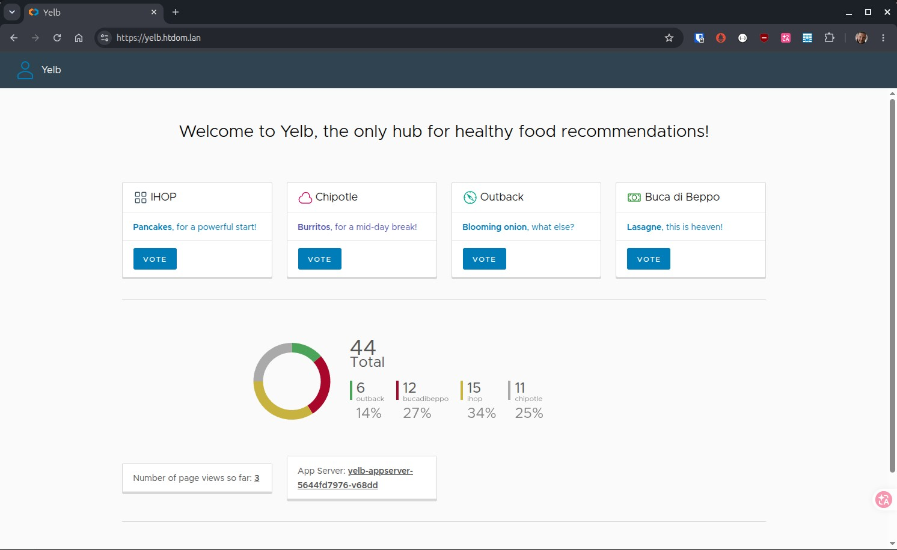

# yelb Demo Application

<p>
  
</p>

   

---

* [Yelb, yet another sample app](https://it20.info/2017/07/yelb-yet-another-sample-app/)
* [yelb Github Repo](https://github.com/mreferre/yelb)

---

[Back to home](../../README.md)

---

## Beschreibung

Yelb ist eine kleine Webanwendung, mit der sich Restaurant-Empfehlungen abstimmen lassen. Ich nutze das Projekt in meinem K3s-Cluster, um Kubernetes-Themen wie Deployments, Services, Storage, Secrets und Ingress praktisch zu üben.

### Funktionen

- Kubernetes-native Bereitstellung der Anwendung
- PostgreSQL Datenbank mit persistentem Storage
- Redis zur Speicherung der Page Views
- Separater App Server mit REST API
- Weboberfläche über Kubernetes Ingress
- TLS Verschlüsselung mit cert-manager
- Verwaltung von Kubernetes Secrets mit SOPS
- Deklaratives Deployment mit Kustomize

## Architektur

Yelb besteht aus vier zentralen Komponenten:

| Komponente | Kubernetes-Ressource | Aufgabe |
|---|---|---|
| PostgreSQL | StatefulSet | Persistente Speicherung der Restaurant-Stimmen |
| Redis | Deployment | Speicherung der Page-View-Zähler |
| App Server | Deployment | REST-API und Anwendungslogik |
| UI | Deployment | Weboberfläche |

Jede Komponente wird intern über einen Kubernetes Service erreichbar gemacht.

```text
                         Browser
                            |
                            v
                  https://yelb.htdom.lan
                            |
                            v
                    Ingress Controller
                            |
                            v
                         yelb-ui
                            |
                            v
                     yelb-appserver
                       /          \
                      v            v
                    yelb-db    yelb-redis
                  PostgreSQL      Redis
```

Aufruf: <https://yelb.htdom.lan>

## Voraussetzungen

- K3s-Cluster und `kubectl`
- Ingress Controller und cert-manager sind eingerichtet
- DNS für `yelb.htdom.lan` zeigt auf den Ingress
- PostgreSQL-Storage ist vorbereitet
- SOPS ist konfiguriert, um das Datenbank-Secret zu entschlüsseln

## Deployment

Die Manifeste liegen unter `apps/yelb/`. Zuerst den Namespace anlegen:

```bash
kubectl apply -f apps/yelb/namespace.yaml
```

Das Datenbank-Secret entschlüsseln und anwenden:

```bash
sops -d apps/yelb/secrets/yelb-db-secret.yaml | kubectl apply -f -
```

> Falls das Secret bei dir an einem anderen Pfad liegt, den Pfad entsprechend anpassen.

Anschließend die Anwendung mit Kustomize deployen:

```bash
kubectl apply -k apps/yelb/
```

## Status prüfen

```bash
kubectl get pods -n yelb -o wide
kubectl get svc,ingress,certificate -n yelb
kubectl get pv,pvc
```

Bei Problemen helfen die Logs und Events:

```bash
kubectl logs -n yelb deployment/yelb-appserver
kubectl logs -n yelb deployment/yelb-redis
kubectl logs -n yelb yelb-db-0
kubectl get events -n yelb --sort-by=.lastTimestamp
```

## Funktion testen

Im Browser öffnen:

<https://yelb.htdom.lan>

Die Restaurants sollten angezeigt werden. Stimmen und Page View Zähler testen. Bei Problemen zuerst prüfen, ob die Pods bereit sind und die Services Endpoints haben:

```bash
kubectl get endpoints -n yelb
```

Die wichtigsten Verbindungen sind:

```text
Browser -> Ingress -> yelb-ui -> yelb-appserver -> PostgreSQL
                                               -> Redis
```

## Hinweise

- PostgreSQL nutzt ein PersistentVolume. PV/PVC oder Datenverzeichnisse nicht unüberlegt löschen.
- Zugangsdaten liegen in einem Kubernetes Secret und werden mit SOPS verschlüsselt verwaltet.
- Der Datenbank-Init wird über die vorhandene Konfiguration bereitgestellt. Bei einer bereits initialisierten Datenbank werden Init-Skripte nicht erneut ausgeführt.
- Änderungen an Service-Namen müssen auch in der Konfiguration des App Servers angepasst werden.

## Aufräumen

```bash
kubectl delete -k apps/yelb/
```

**Achtung:** Vor dem Löschen prüfen, welche PersistentVolumes und Daten erhalten bleiben sollen.

---

Zur Vorbereitung auf die CKA nutze ich Yelb, um Deployments, StatefulSets, Services, ConfigMaps, Secrets, PersistentVolumes, Ingress und Troubleshooting praktisch zu üben.
