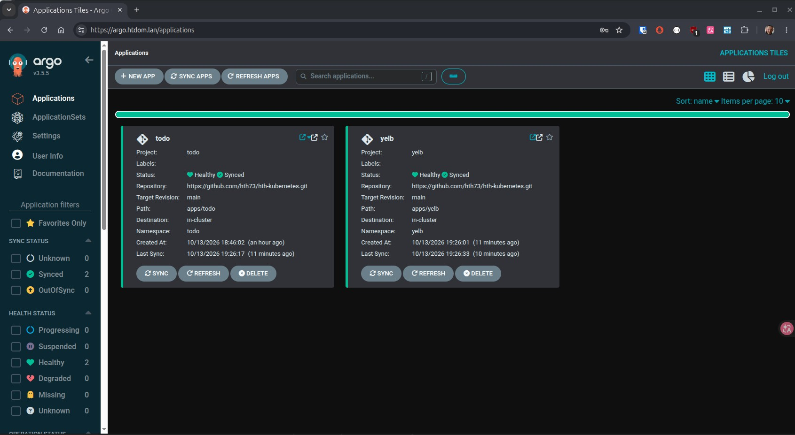

# Argo CD – GitOps im Kubernetes-Homelab

<p>
  
</p>

---

* [ArgoCD Dokumentation](https://argo-cd.readthedocs.io/en/stable/getting_started)

---

[Back to home](../../README.md)

---


## Übersicht

Argo CD übernimmt die kontinuierliche Überwachung und Synchronisierung von Kubernetes-Ressourcen anhand der Manifeste im Git-Repository.

**Repository:** [hth-kubernetes](https://github.com/hth73/hth-kubernetes)

**Git-Repository-URL:** `https://github.com/hth73/hth-kubernetes.git`

## Installation

Argo CD wurde in der Standardinstallation installiert. Die zuvor getestete HA-Installation wurde durch die Standardinstallation ersetzt.

Namespace erstellen:

```bash
kubectl create namespace argocd
```

Argo CD installieren:

```bash
kubectl apply -n argocd --server-side --force-conflicts \
  -f https://raw.githubusercontent.com/argoproj/argo-cd/v3.5.5/manifests/install.yaml
```

Status prüfen:

```bash
kubectl get pods -n argocd
kubectl get services -n argocd
```

## Zugriff über HTTPS

Argo CD ist über folgende interne Adresse erreichbar:

`https://argo.htdom.lan`

Der Zugriff erfolgt über Traefik. Das TLS-Zertifikat wird von cert-manager über den vorhandenen `ClusterIssuer` `htdom-sub-ca` ausgestellt.

Für die TLS-Terminierung am Ingress wurde Argo CD auf den internen HTTP-Modus eingestellt:

```bash
kubectl patch configmap argocd-cmd-params-cm \
  -n argocd \
  --type merge \
  -p '{"data":{"server.insecure":"true"}}'
```

Anschließend wurde der Server neu gestartet:

```bash
kubectl rollout restart deployment argocd-server -n argocd
kubectl rollout status deployment argocd-server -n argocd
```

**Hinweis:** TLS wird am Ingress terminiert. Die Einstellung `server.insecure: "true"` betrifft die interne Verbindung zum Argo-CD-Server und ersetzt nicht das TLS-Zertifikat am Ingress.

## Zugangsdaten

Das initiale Admin-Passwort wurde aus dem Kubernetes-Secret ausgelesen und in `gopass` gespeichert.

```bash
kubectl get secret argocd-initial-admin-secret -n argocd -o jsonpath='{.data.password}' | base64 --decode
```

Das Passwort wurde anschließend geändert. Das Secret `argocd-initial-admin-secret` wurde nach der Änderung gelöscht.

```bash
## Nach Passwort änderung in ArgoCD, das initial Password in K8s löschen
kubectl delete secret argocd-initial-admin-secret -n argocd
kubectl get secret argocd-initial-admin-secret -n argocd
```

## AppProjects

Für die Anwendungen wurden separate Argo-CD-Projekte angelegt:

| Projekt | Zweck |
|---|---|
| `default` | Standardprojekt von Argo CD |
| `todo` | Todo-Anwendung |
| `yelb` | Yelb-Anwendung |

Die Projekte `todo` und `yelb` beschränken die erlaubten Git-Repositories auf das eigene Repository und die Deployment-Ziele auf den jeweils vorgesehenen Namespace.

Beispiel der Konfiguration für das Projekt `todo`:

```yaml
apiVersion: argoproj.io/v1alpha1
kind: AppProject
metadata:
  name: todo
  namespace: argocd

spec:
  description: Todo List Demo Application
  sourceRepos:
    - https://github.com/hth73/hth-kubernetes.git
  destinations:
    - name: in-cluster
      namespace: todo
      server: https://kubernetes.default.svc
  clusterResourceWhitelist:
    - group: '*'
      kind: '*'
```

**Sicherheitshinweis:** Die `clusterResourceWhitelist` erlaubt aktuell alle clusterweiten Ressourcentypen. Eine Einschränkung auf die tatsächlich benötigten Ressourcen ist als mögliche spätere Verbesserung vorgesehen.

## Applications

Die Applications verwenden das Repository `hth-kubernetes` als Quelle.

Beispiel für die Todo-Application:

```yaml
---
apiVersion: argoproj.io/v1alpha1
kind: Application
metadata:
  name: todo
  namespace: argocd

spec:
  project: todo
  source:
    repoURL: https://github.com/hth73/hth-kubernetes.git
    targetRevision: main
    path: apps/todo
  destination:
    server: https://kubernetes.default.svc
    namespace: todo
```

Die AppProject- und Application-Manifeste werden derzeit manuell mit `kubectl apply` auf den Cluster angewendet. Sie liegen im Repository, werden aber noch nicht automatisch durch eine übergeordnete Argo-CD-Application verwaltet.

## GitOps-Workflow

Der aktuelle Workflow sieht folgendermaßen aus:

1. Änderungen an den Kubernetes-Manifesten lokal vornehmen.
2. Änderungen prüfen und in Git committen.
3. Änderungen nach GitHub pushen.
4. Argo CD erkennt die neue Revision und gleicht den Git-Zustand mit dem Cluster ab.
5. Bei deaktivierter automatischer Synchronisierung wird die Synchronisierung manuell in der Argo-CD-Weboberfläche gestartet.
6. Nach dem Sync werden Synchronisierungs- und Health-Status kontrolliert.

### Beispiel: Änderungen überprüfen

```bash
git diff
git status
```

### Änderungen committen und pushen

```bash
git add <dateien>
git commit -m "Beschreibung der Änderung"
git push
```

### Application-Status kontrollieren

```bash
kubectl get applications -n argocd
kubectl get application todo -n argocd
kubectl get application yelb -n argocd
```

Eine erfolgreiche Synchronisierung wird mit `Synced` angezeigt. Ein gesunder Zustand wird mit `Healthy` angezeigt.

### RollingUpdates beobachten

Wenn eine Änderung an einem Deployment einen neuen Pod benötigt, kann das RollingUpdate nach dem manuellen Sync beobachtet werden:

```bash
kubectl rollout status deployment/todo-ui -n todo
kubectl get pods -n todo -w
```

Nicht jede Git-Änderung löst einen RollingUpdate aus. Änderungen an einem Deployment-Pod-Template, beispielsweise am Container-Image, können einen neuen Rollout auslösen. Änderungen ausschließlich an Metadaten des Deployments müssen das nicht tun.

## Nützliche Befehle

### Projekte auflisten

```bash
kubectl get appprojects -n argocd
```

### Applications auflisten

```bash
kubectl get applications -n argocd
```

### AppProject anzeigen

```bash
kubectl get appproject todo -n argocd -o yaml
kubectl get appproject yelb -n argocd -o yaml
```

### Application-Konfiguration prüfen

```bash
kubectl get application todo -n argocd -o yaml
kubectl get application yelb -n argocd -o yaml
```

### Argo-CD-Pods prüfen

```bash
kubectl get pods -n argocd
```

## Aktueller Stand

- [x] Argo CD installiert
- [x] HTTPS-Zugriff über Traefik eingerichtet
- [x] TLS-Zertifikat über cert-manager eingerichtet
- [x] Admin-Passwort geändert und im Passwortmanager gespeichert
- [x] AppProject `todo` angelegt
- [x] AppProject `yelb` angelegt
- [x] Application `todo` angelegt und synchronisiert
- [x] Application `yelb` angelegt und synchronisiert
- [x] GitOps-Test mit einer Manifeständerung erfolgreich durchgeführt
- [x] Manueller Sync über die Argo-CD-Weboberfläche getestet
