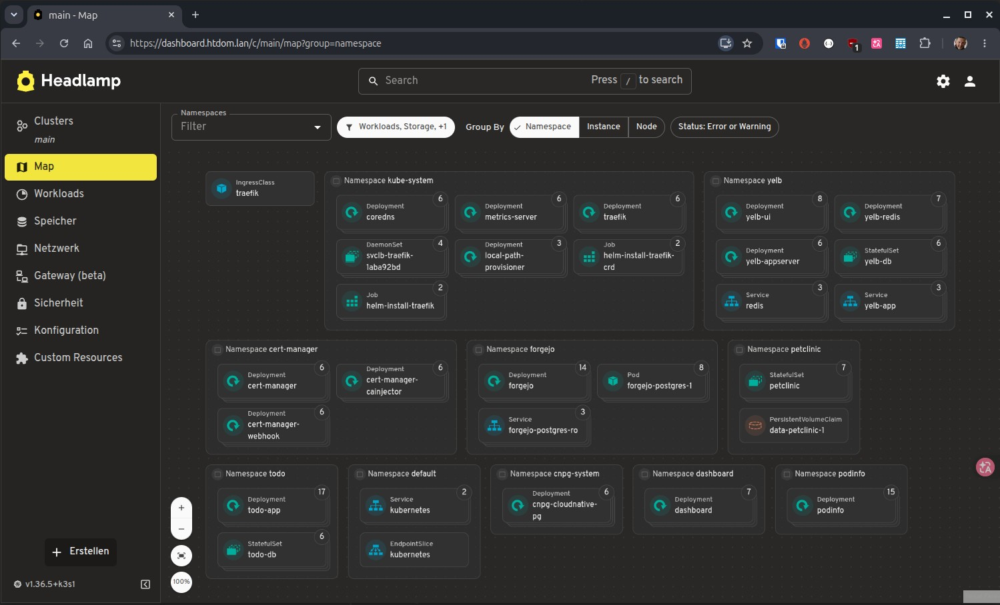

# Headlamp Kubernetes UI

<p>
  
</p>

---

* [Headlamp Kubernetes UI](https://headlamp.dev/)

---

[Back to home](../../README.md)

---

## Description

Headlamp is a web-based Kubernetes dashboard for inspecting and managing Kubernetes resources through a graphical interface.

## Features

- Web-based Kubernetes management UI
- Resource inspection and YAML editing
- Pod logs and terminal access where supported by the container image
- TLS encryption via cert-manager
- Ingress access through Traefik
- RBAC-based access control

## Architecture

- **Namespace:** `dashboard`
- **Application:** Headlamp `v0.45.0`
- **Service:** `dashboard` (port 80 → container port 4466)
- **Ingress:** `dashboard.htdom.lan`
- **TLS:** cert-manager with `htdom-sub-ca`
- **RBAC:** Custom cluster-wide editor role and namespace-specific developer bindings

## Access

Open Headlamp in your browser:

[https://dashboard.htdom.lan](https://dashboard.htdom.lan)

A Kubernetes ServiceAccount token is used for authentication in the current lab setup.

## RBAC

- **DevOps:** Cluster-wide read and selected write permissions through `dashboard-cluster-editor`.
- **Developers:** The built-in `edit` ClusterRole bound within selected namespaces (`petclinic`, `podinfo`, `todo`, and `yelb`).

The effective permissions depend on the active Kubernetes identity and its RBAC bindings.

## Deployment

Deploy the manifests using Kustomize:

```bash
kubectl apply -k apps/headlamp/
```

Check the deployment:

```bash
kubectl get pods,svc,ingress -n dashboard
kubectl get certificate -n dashboard
kubectl auth can-i patch deployments \
  --all-namespaces \
  --as=system:serviceaccount:dashboard:dashboard
```

Create Access Token for the dashboard

```bash
kubectl create token dashboard -n dashboard
```

## Notes

- Headlamp complements `kubectl` and `k9s` with a graphical interface.
- Changes made directly in Headlamp are not automatically committed to Git. Update the manifests in `hth-kubernetes` to preserve tested changes.
- Containers without a shell cannot provide an interactive shell through the normal terminal feature. Use an appropriate debugging method when necessary.
